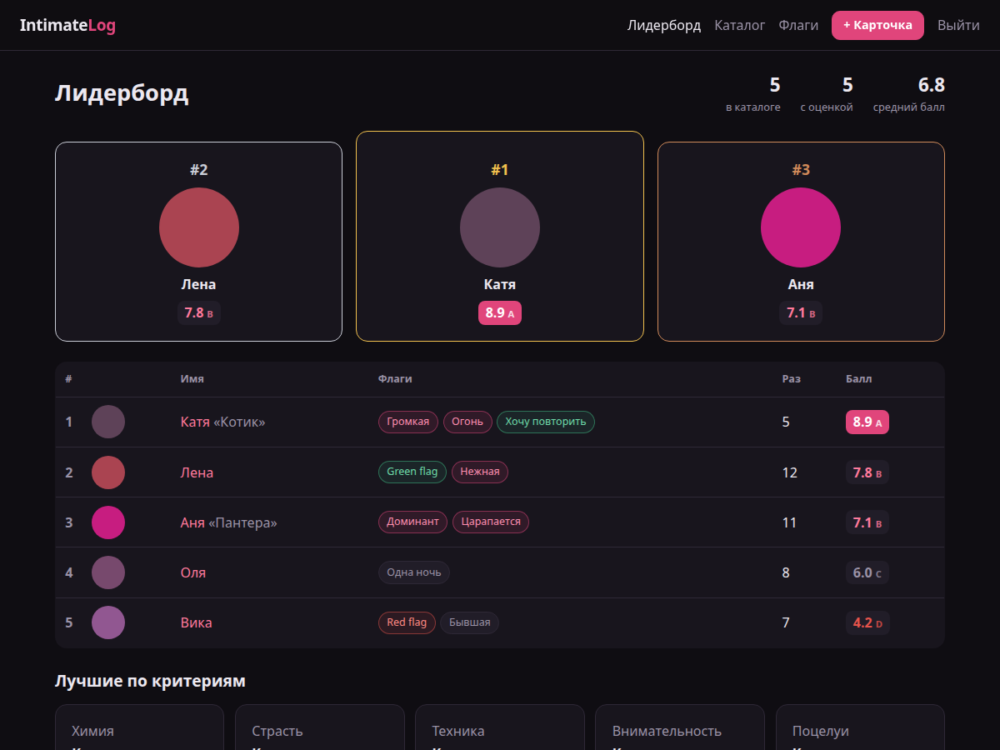
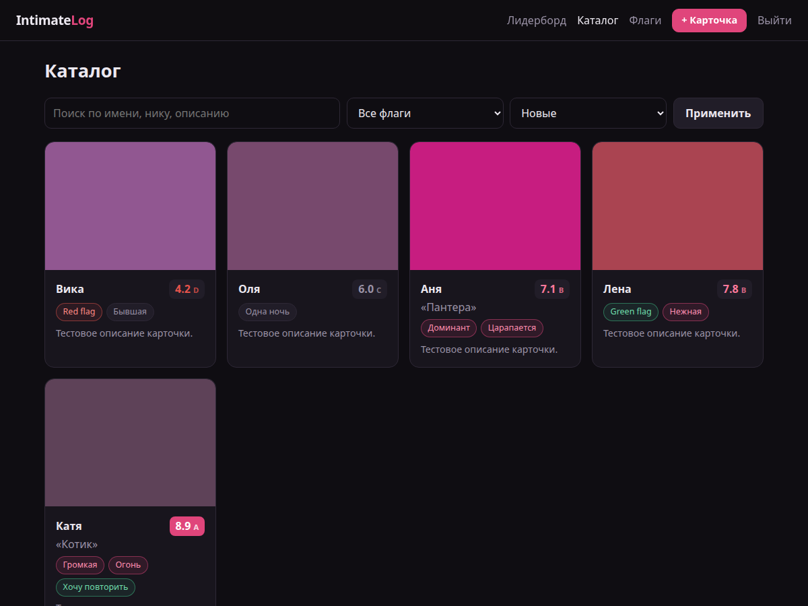
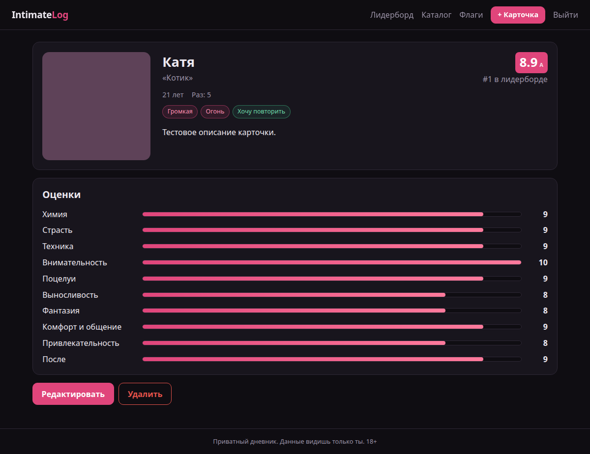
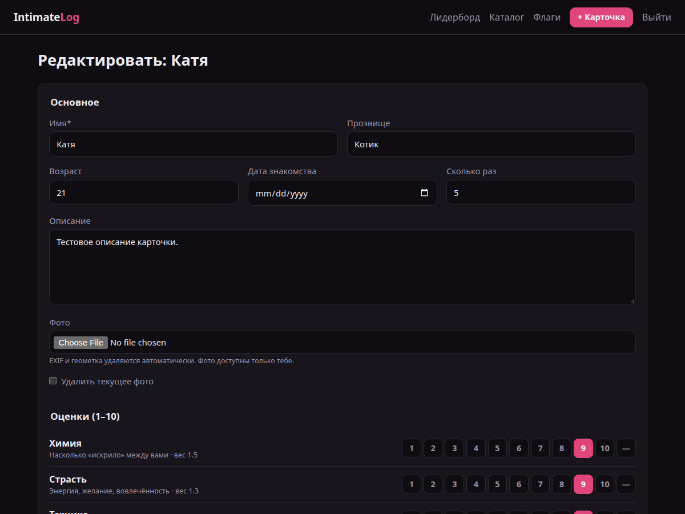
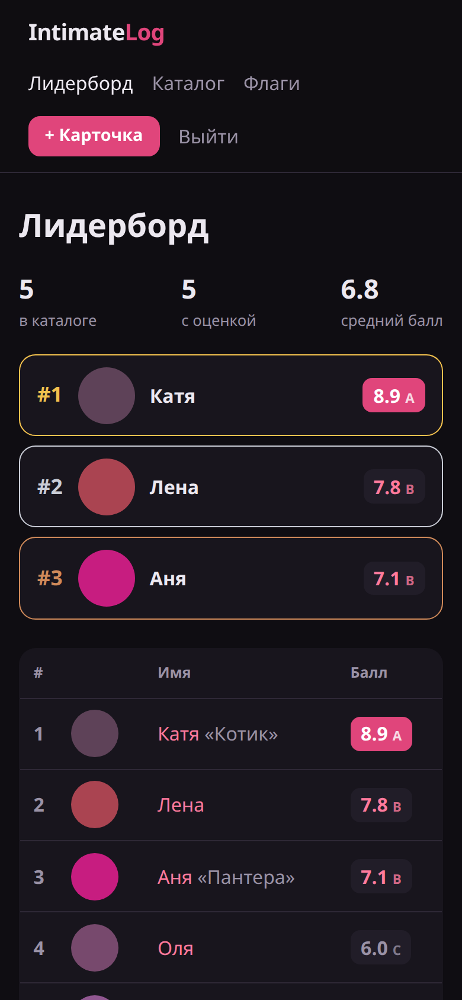

<div align="center">

# IntimateLog

**A private, self-hosted diary for your love life — with ratings, spicy flags and a leaderboard.**
**Приватный self-hosted дневник личной жизни — с оценками, пикантными флагами и лидербордом.**

[](https://github.com/SirEdwinDrow/intimate-log/actions/workflows/ci.yml)


### [English](#english) · [Русский](#russian)



</div>

---

<a id="english"></a>

## English

<sub>[Перейти к русской версии ↓](#russian)</sub>

### What is this?

You had a night. Then another one. Then someone asked "so who was the best?" and you said "uhh…" like a peasant.

**Intimate Log** fixes that. It is a tiny web app you run on your own machine (or a Raspberry Pi under your bed — we don't judge) where you:

1. **Create a partner card** — name, nickname, age, when you met, how many times, a description and a photo.
2. **Rate them** on 10 carefully engineered, peer-reviewed-by-nobody criteria.
3. **Slap on flags** — spicy ones, green ones, red ones.
4. **Watch them appear** in the **catalog** and on the **leaderboard**, complete with a podium, because life is a competition and so is this.

Everything stays **yours**: one account sees only its own data, photos never go public, and metadata is stripped before saving. This is a diary, not a dating site, not a social network, and definitely not a group chat screenshot.

### Features

| | |
|---|---|
| **Partner cards** | Name, nickname, age (18+ only, the app enforces it), date met, times counter, free-form description, photo |
| **10 weighted criteria** | Scores from 1 to 10, any of them can be skipped. Weighted average → final score → tier **S / A / B / C / D** |
| **Spicy flags** | 20 presets out of the box plus your own, created right from the card form |
| **Leaderboard** | Top-3 podium (gold, silver, bronze), full ranking table, "best in category" for each criterion, totals and average |
| **Catalog** | Search by name, nickname and description, filter by flag, sort by newest, score, name or times |
| **Photo privacy** | EXIF and GPS tags are wiped, image is resized to 1600 px, served only to the logged-in owner |
| **JSON export** | Download all your data. For backups. Or for your memoirs |
| **Mobile-friendly** | Looks fine on a phone, which is where, let's be honest, you'll be filling it in |
| **Dark theme** | The only theme. Some things are better in the dark |

<details>
<summary><b>More screenshots</b></summary>

| Catalog | Partner profile |
|---|---|
|  |  |

| Rating form | Mobile |
|---|---|
|  |  |

Placeholder photos are solid colors. Your real ones will be more interesting. Probably.

</details>

### The rating system

Ten criteria, each with a weight. Chemistry matters more than stamina — that's science (citation needed).

| Criterion | Weight | What it means |
|---|:---:|---|
| Chemistry | **1.5** | Were there sparks, or just static electricity from the carpet? |
| Passion | 1.3 | Energy, desire, actually being there |
| Attentiveness | 1.3 | Did they care about *your* good time too? |
| Technique | 1.2 | Hands, lips, rhythm. Skill issue or skill flex |
| Comfort & communication | 1.2 | Easy to talk about wishes and boundaries |
| Kissing | 1.0 | A separate art form, deserves its own row |
| Creativity | 1.0 | Open to new things, or strictly the classics |
| Attraction | 1.0 | Looks, smell, voice — whatever does it for you |
| Stamina | 0.9 | Pace and duration. A marathon or a sprint |
| Afterwards | 0.8 | Cuddles, talks, the vibe after the credits roll |

**Final score** = weighted average of the criteria you filled in. Skipped ones don't drag the score down.

| Tier | Score | Translation |
|:---:|:---:|---|
| **S** | ≥ 9.0 | Legendary. Tell no one. Or everyone |
| **A** | ≥ 8.0 | Excellent, would recommend (to yourself) |
| **B** | ≥ 6.5 | Solid. Good times |
| **C** | ≥ 5.0 | It happened |
| **D** | < 5.0 | Character development |

Want different criteria or weights? Edit `app/scoring.py`. It's one list. You're a developer, you've got this.

### Flags

Four colors of flags, 20 presets out of the box (UI labels are in Russian):

- **Spicy** — "On fire", "Loves experiments", "Loud", "Dominant", "Submissive", "Role play", "Marathon runner", "Insatiable", "Morning person", "Gentle", "Scratches", "Lingerie on point"
- **Green** — "Want a repeat", "Green flag", "Talks about desires"
- **Red** — "Red flag", "Never again"
- **Neutral** — "Ex", "One night", "Relationship"

Add your own on the **Flags** page or right in the card form. Tags are per-account, so your weird ones stay your weird ones.

### Quick start

### Option A — Docker (recommended for servers and Raspberry Pi)

```bash
git clone https://github.com/SirEdwinDrow/intimate-log.git
cd intimate-log
cp .env.example .env
# put a real secret in .env:
python -c "import secrets;print(secrets.token_urlsafe(48))"
docker compose up -d --build
```

Open **http://127.0.0.1:8000**, register, then set `ALLOW_REGISTRATION=false` in `.env` and run `docker compose up -d` again. Now nobody else can sign up. Not even your ex.

### Option B — Windows without Docker

You need a **regular** Python 3.10–3.14 from [python.org](https://www.python.org/downloads/).

> **Heads-up:** the *free-threaded* build (`3.13t`) won't work — there are no prebuilt packages for it and pip will try to compile Pillow from scratch, and fail spectacularly. The script below detects this and picks the right Python for you.

```powershell
powershell -ExecutionPolicy Bypass -File .\run.ps1
```

The script finds a suitable Python, creates `.venv`, installs dependencies, generates a persistent `SECRET_KEY` into `.secret_key` and starts the server at **http://127.0.0.1:8000**.

### Option C — Linux / macOS, manually

```bash
python3 -m venv .venv && source .venv/bin/activate
pip install -r requirements.txt            # + requirements-heif.txt for iPhone HEIC photos
export SECRET_KEY="$(python -c 'import secrets;print(secrets.token_urlsafe(48))')"
uvicorn app.main:app --host 127.0.0.1 --port 8000
```

### Configuration

All settings are environment variables (or `.env` for Docker).

| Variable | Default | What it does |
|---|---|---|
| `SECRET_KEY` | `dev-insecure-change-me` | Signs session cookies. **Change it.** Seriously |
| `ALLOW_REGISTRATION` | `true` | Set to `false` after creating your account. The first user can always register |
| `HTTPS_ONLY` | `false` | Set to `true` behind HTTPS (tunnel / reverse proxy) — cookies become `Secure` |
| `MAX_UPLOAD_MB` | `10` | Max photo size |
| `DATA_DIR` | `./data` | Where the database and photos live |
| `DATABASE_URL` | `sqlite:///<DATA_DIR>/app.db` | Any SQLAlchemy URL if SQLite feels too humble |
| `UPLOAD_DIR` | `<DATA_DIR>/uploads` | Photo storage |

### Exposing it to the internet (HTTPS via Tuna)

By default the app listens on `127.0.0.1` only. To open it from your phone outside of home, use a tunnel, for example [Tuna](https://tuna.am/docs/tunnels/http/):

```powershell
winget install --id yuccastream.tuna
tuna config save-token <YOUR_TOKEN>

# window 1 — the app
$env:HTTPS_ONLY = "true"
$env:ALLOW_REGISTRATION = "false"
powershell -ExecutionPolicy Bypass -File .\run.ps1

# window 2 — the tunnel
tuna http 8000 --subdomain=<your-free-subdomain> --https-redirect --inspect=false
```

| Address | Flag | Plan |
|---|---|---|
| `brave-otter-4821.ru.tuna.am` (random but permanent) | `--subdomain=brave-otter-4821` | free |
| `yourname.ru.tuna.am` (your choice) | `--subdomain=yourname` | subscription |
| `log.your-domain.com` (your own domain) | `--domain=log.your-domain.com` | subscription + a domain you actually own |

> **`Domain does not exist`?** You can't just make up a domain like `intim.log.ru` — you have to own it, add it in the Tuna dashboard and confirm it via DNS. The internet is not a wish-granting machine.

`--inspect=false` turns off Tuna's local request inspector, which would otherwise happily log your login password. Recommended.

### Privacy and security

This app holds the most sensitive data imaginable, so it is built paranoid:

- **Account isolation** — every query is scoped to the owner. User A can't see, edit, delete or even view a photo of User B's cards. There are tests for that
- **Private photos** — no public static folder. Photos are served through an endpoint that checks ownership
- **Metadata wipe** — EXIF, GPS coordinates and camera model are stripped on upload. Your bedroom's coordinates stay off the record
- **Passwords** — PBKDF2-SHA256, 390,000 iterations, random salt
- **CSRF tokens** on every form, `SameSite=Lax` session cookie, optional `Secure` flag
- **`noindex, nofollow`** — search engines are politely asked to look away
- **Docker** runs as a non-root user and binds to `127.0.0.1` only
- **Path traversal** attempts on photo URLs return a polite 404

**Backups:** everything lives in the `data/` folder (one SQLite file + photos). Copy it somewhere safe. Encrypted somewhere, ideally.

### Running tests

```bash
pip install -r requirements-dev.txt
pytest -v
```

18 tests cover: auth, CSRF, validation (including the 18+ check), full card lifecycle, leaderboard ordering, catalog search/filter/sort, flags CRUD, photo metadata stripping, account isolation, path traversal and closed registration.

CI on every push runs:
- **Linux** — tests
- **Windows** — install without a compiler, tests, `run.ps1` syntax check, server smoke test
- **Docker** — image build plus a container smoke test

### Project structure

```
app/
  main.py          routes: auth, cards, catalog, leaderboard, flags, export
  db.py            SQLAlchemy models: User, Partner, Score, Flag
  scoring.py       criteria, weights, tiers, preset flags  ← tweak me
  images.py        photo validation, EXIF stripping, resize
  security.py      password hashing, CSRF
  templates/       Jinja2 HTML
  static/style.css the whole design in one file
tests/             pytest suite
run.ps1            one-click Windows launcher
Dockerfile, docker-compose.yml
```

### Routes

| Method | Path | What |
|---|---|---|
| GET | `/leaderboard` | The podium of glory |
| GET | `/catalog?q=&flag=&sort=` | Everyone, searchable |
| GET/POST | `/partners/new`, `/partners` | Create a card |
| GET | `/partners/{id}` | Profile with score bars |
| GET/POST | `/partners/{id}/edit` | Edit |
| POST | `/partners/{id}/delete` | Delete (with photo) |
| GET/POST | `/flags` | Manage flags |
| GET | `/export` | JSON dump of your data |
| GET | `/healthz` | `{"status": "ok"}` — the app is alive, unlike some relationships |

### FAQ

**Is this ethical?**
It's a private diary. People have kept those for centuries, we just added a weighted average. Keep it private, don't share other people's data or photos without consent, and be nice.

**Can my partner see their score?**
Only if you show them. Which we do not recommend unless they're an S tier.

**Why is "Afterwards" weighted the lowest?**
Open an issue. Or a PR. Or a therapy session.

**Can I add guys / non-binary partners?**
Of course. The cards are for anyone; the name field doesn't care.

**Is there an API?**
There's `/export`. Anything more and it starts feeling like a business plan.

**I forgot my password.**
There's no reset — no email, no data leaks. Stop the app and delete `data/app.db` to start over (yes, losing everything). Or don't forget your password.

### License

Private project. All rights reserved. Use responsibly, 18+ only.

<p align="right"><a href="#english">↑ Back to top</a></p>

---

<a id="russian"></a>

## Русский

<sub>[Go to English version ↑](#english)</sub>

### Что это такое

Была ночь. Потом ещё одна. Потом друг спросил «ну и кто был лучше всех?», а ты ответил «эээ…», как пещерный человек без Excel.

**Intimate Log** решает эту проблему. Это маленькое веб-приложение, которое крутится на твоём компьютере (или на Raspberry Pi под кроватью — мы не осуждаем). В нём ты:

1. **Создаёшь карточку партнёра** — имя, прозвище, возраст, дата знакомства, сколько раз, описание и фото.
2. **Ставишь оценки** по 10 тщательно продуманным критериям, которые не рецензировал ни один учёный.
3. **Вешаешь флаги** — пикантные, зелёные, красные.
4. **Смотришь, как карточка появляется** в **каталоге** и в **лидерборде** с пьедесталом, потому что жизнь — соревнование, и это тоже.

Всё остаётся **только твоим**: каждый аккаунт видит лишь свои данные, фото никогда не попадают в открытый доступ, метаданные вычищаются перед сохранением. Это дневник, а не сайт знакомств, не соцсеть и точно не скриншот в общий чат.

### Возможности

| | |
|---|---|
| **Карточки партнёров** | Имя, прозвище, возраст (только 18+, приложение это проверяет), дата знакомства, счётчик раз, описание, фото |
| **10 критериев с весами** | Оценки от 1 до 10, любой можно пропустить. Взвешенное среднее → итоговый балл → тир **S / A / B / C / D** |
| **Пикантные флаги** | 20 готовых из коробки плюс свои, которые создаются прямо в форме карточки |
| **Лидерборд** | Пьедестал топ-3 (золото, серебро, бронза), полная таблица, «лучшая в номинации» по каждому критерию, общая статистика |
| **Каталог** | Поиск по имени, прозвищу и описанию, фильтр по флагу, сортировка по новизне, баллу, имени или количеству раз |
| **Приватность фото** | EXIF и GPS удаляются, фото ужимается до 1600 px и показывается только владельцу после входа |
| **Экспорт в JSON** | Скачай все свои данные. Для бэкапа. Или для мемуаров |
| **Мобильная вёрстка** | Нормально смотрится на телефоне — давай честно, заполнять ты будешь именно с него |
| **Тёмная тема** | Единственная. Некоторые вещи лучше в темноте |

<details>
<summary><b>Ещё скриншоты</b></summary>

| Каталог | Профиль |
|---|---|
|  |  |

| Форма оценки | Телефон |
|---|---|
|  |  |

На демо вместо фото однотонные квадраты. Твои будут поинтереснее. Наверное.

</details>

### Система оценок

Десять критериев, у каждого свой вес. Химия важнее выносливости — это наука (источник не найден).

| Критерий | Вес | Что оцениваем |
|---|:---:|---|
| Химия | **1.5** | Искрило — или это просто статическое электричество от ковра? |
| Страсть | 1.3 | Энергия, желание, вовлечённость |
| Внимательность | 1.3 | Думали ли о *твоём* удовольствии тоже |
| Техника | 1.2 | Руки, губы, ритм. Skill issue или skill flex |
| Комфорт и общение | 1.2 | Легко ли говорить о желаниях и границах |
| Поцелуи | 1.0 | Отдельный вид искусства, заслуживает своей строки |
| Фантазия | 1.0 | Открытость к новому или строго классика |
| Привлекательность | 1.0 | Внешность, запах, голос — всё, что заводит |
| Выносливость | 0.9 | Темп и продолжительность. Марафон или спринт |
| После | 0.8 | Объятия, разговоры, атмосфера после титров |

**Итоговый балл** — взвешенное среднее по заполненным критериям. Пропущенные не тянут балл вниз.

| Тир | Балл | Перевод на человеческий |
|:---:|:---:|---|
| **S** | ≥ 9.0 | Легенда. Никому не рассказывай. Или всем |
| **A** | ≥ 8.0 | Отлично, рекомендую (себе) |
| **B** | ≥ 6.5 | Крепко. Было хорошо |
| **C** | ≥ 5.0 | Ну, это было |
| **D** | < 5.0 | Опыт тоже результат |

Хочешь другие критерии или веса? Правь `app/scoring.py`. Там один список. Ты разработчик, справишься.

### Флаги

Четыре цвета, 20 готовых флагов:

- **Пикантные** — «Огонь», «Любит эксперименты», «Громкая», «Доминант», «Нижняя», «Ролевые игры», «Марафонец», «Ненасытная», «Утренняя», «Нежная», «Царапается», «Белье огонь»
- **Зелёные** — «Хочу повторить», «Green flag», «Говорит о желаниях»
- **Красные** — «Red flag», «Больше не повторю»
- **Нейтральные** — «Бывшая», «Одна ночь», «Отношения»

Свои добавляются на странице **«Флаги»** или прямо в форме карточки. Флаги привязаны к аккаунту, так что твои странные остаются твоими странными.

### Быстрый старт

### Вариант A — Docker (для сервера и Raspberry Pi)

```bash
git clone https://github.com/SirEdwinDrow/intimate-log.git
cd intimate-log
cp .env.example .env
# впиши настоящий секрет в .env:
python -c "import secrets;print(secrets.token_urlsafe(48))"
docker compose up -d --build
```

Открой **http://127.0.0.1:8000** и зарегистрируйся. Потом поставь `ALLOW_REGISTRATION=false` в `.env` и снова выполни `docker compose up -d`. Теперь больше никто не сможет зарегистрироваться. Даже бывшая.

### Вариант B — Windows без Docker

Нужен **обычный** Python 3.10–3.14 с [python.org](https://www.python.org/downloads/).

> **Внимание:** *free-threaded* сборка (`3.13t`) не подойдёт. Под неё нет готовых пакетов, pip начнёт компилировать Pillow с нуля и эффектно упадёт. Скрипт ниже сам это заметит и выберет нужный Python.

```powershell
powershell -ExecutionPolicy Bypass -File .\run.ps1
```

Скрипт найдёт подходящий Python, создаст `.venv`, поставит зависимости, сохранит постоянный `SECRET_KEY` в `.secret_key` и запустит сервер на **http://127.0.0.1:8000**.

### Вариант C — Linux / macOS вручную

```bash
python3 -m venv .venv && source .venv/bin/activate
pip install -r requirements.txt            # + requirements-heif.txt для HEIC-фото с iPhone
export SECRET_KEY="$(python -c 'import secrets;print(secrets.token_urlsafe(48))')"
uvicorn app.main:app --host 127.0.0.1 --port 8000
```

### Настройки

Все настройки задаются переменными окружения (или через `.env` для Docker).

| Переменная | По умолчанию | Что делает |
|---|---|---|
| `SECRET_KEY` | `dev-insecure-change-me` | Подписывает cookie сессии. **Поменяй.** Серьёзно |
| `ALLOW_REGISTRATION` | `true` | Поставь `false` после создания своего аккаунта. Первый пользователь может зарегистрироваться всегда |
| `HTTPS_ONLY` | `false` | Поставь `true`, если сервис работает за HTTPS (туннель, reverse proxy) — cookie станут `Secure` |
| `MAX_UPLOAD_MB` | `10` | Максимальный размер фото |
| `DATA_DIR` | `./data` | Где лежат база и фото |
| `DATABASE_URL` | `sqlite:///<DATA_DIR>/app.db` | Любой URL SQLAlchemy, если SQLite кажется слишком скромной |
| `UPLOAD_DIR` | `<DATA_DIR>/uploads` | Папка для фото |

### Доступ из интернета (HTTPS через Tuna)

По умолчанию приложение слушает только `127.0.0.1`. Чтобы открыть его с телефона вне дома, подними туннель, например через [Tuna](https://tuna.am/docs/tunnels/http/):

```powershell
winget install --id yuccastream.tuna
tuna config save-token <ТВОЙ_ТОКЕН>

# окно 1 — приложение
$env:HTTPS_ONLY = "true"
$env:ALLOW_REGISTRATION = "false"
powershell -ExecutionPolicy Bypass -File .\run.ps1

# окно 2 — туннель
tuna http 8000 --subdomain=<твой-бесплатный-поддомен> --https-redirect --inspect=false
```

| Адрес | Флаг | Тариф |
|---|---|---|
| `brave-otter-4821.ru.tuna.am` (случайный, но постоянный) | `--subdomain=brave-otter-4821` | бесплатно |
| `yourname.ru.tuna.am` (имя на выбор) | `--subdomain=yourname` | подписка |
| `log.твой-домен.ru` (свой домен) | `--domain=log.твой-домен.ru` | подписка + домен, который у тебя реально есть |

> **Ошибка `Domain does not exist`?** Нельзя просто придумать домен вроде `intim.log.ru`. Его нужно купить, добавить в кабинете Tuna и подтвердить через DNS. Интернет — не золотая рыбка.

`--inspect=false` выключает локальную панель Tuna, которая иначе записала бы все запросы вместе с твоим паролем при входе. Рекомендуется.

### Приватность и безопасность

Здесь хранятся самые чувствительные данные, какие только можно придумать, поэтому приложение сделано параноидально:

- **Изоляция аккаунтов** — каждый запрос ограничен владельцем. Пользователь А не может увидеть, изменить, удалить карточки пользователя Б или даже открыть его фото. На это есть тесты
- **Приватные фото** — никакой открытой папки со статикой. Фото отдаются через эндпоинт, который проверяет владельца
- **Удаление метаданных** — EXIF, GPS-координаты и модель камеры вычищаются при загрузке. Координаты твоей спальни никуда не попадут
- **Пароли** — PBKDF2-SHA256, 390 000 итераций, случайная соль
- **CSRF-токены** на всех формах, cookie сессии с `SameSite=Lax` и опциональным флагом `Secure`
- **`noindex, nofollow`** — поисковиков вежливо просят отвернуться
- **Docker** работает от непривилегированного пользователя и слушает только `127.0.0.1`
- **Path traversal** в адресах фото получает вежливый 404

**Бэкапы:** всё лежит в папке `data/` (один файл SQLite и фото). Копируй её в надёжное место. В идеале — в зашифрованное.

### Тесты

```bash
pip install -r requirements-dev.txt
pytest -v
```

18 тестов проверяют: вход и регистрацию, CSRF, валидацию (включая проверку 18+), полный цикл карточки, порядок в лидерборде, поиск/фильтр/сортировку каталога, работу с флагами, удаление метаданных из фото, изоляцию аккаунтов, path traversal и закрытую регистрацию.

CI на каждый push:
- **Linux** — тесты
- **Windows** — установка без компилятора, тесты, проверка синтаксиса `run.ps1`, тестовый запуск сервера
- **Docker** — сборка образа и проверка, что контейнер стартует

### Структура проекта

```
app/
  main.py          маршруты: вход, карточки, каталог, лидерборд, флаги, экспорт
  db.py            модели SQLAlchemy: User, Partner, Score, Flag
  scoring.py       критерии, веса, тиры, готовые флаги  ← правь меня
  images.py        проверка фото, удаление EXIF, ресайз
  security.py      хэширование паролей, CSRF
  templates/       HTML на Jinja2
  static/style.css весь дизайн в одном файле
tests/             тесты pytest
run.ps1            запуск на Windows в одну команду
Dockerfile, docker-compose.yml
```

### Маршруты

| Метод | Путь | Что там |
|---|---|---|
| GET | `/leaderboard` | Пьедестал славы |
| GET | `/catalog?q=&flag=&sort=` | Все карточки с поиском |
| GET/POST | `/partners/new`, `/partners` | Создать карточку |
| GET | `/partners/{id}` | Профиль с полосками оценок |
| GET/POST | `/partners/{id}/edit` | Редактирование |
| POST | `/partners/{id}/delete` | Удаление (вместе с фото) |
| GET/POST | `/flags` | Управление флагами |
| GET | `/export` | Все твои данные в JSON |
| GET | `/healthz` | `{"status": "ok"}` — приложение живо, в отличие от некоторых отношений |

### FAQ

**Это вообще этично?**
Это личный дневник. Люди ведут их веками, мы просто добавили взвешенное среднее. Держи его в секрете, не публикуй чужие данные и фото без согласия, и будь человеком.

**Партнёр может увидеть свою оценку?**
Только если ты покажешь. Не советуем, если там не S-тир.

**Почему у «После» самый маленький вес?**
Открой issue. Или PR. Или запишись к психологу.

**Можно добавлять парней и небинарных партнёров?**
Конечно. Карточки подходят для кого угодно, полю «Имя» всё равно.

**А API есть?**
Есть `/export`. Если добавить что-то ещё, это уже начнёт походить на бизнес-план.

**Я забыл пароль.**
Сброса нет: нет почты — нет утечек. Останови приложение и удали `data/app.db`, чтобы начать заново (да, потеряв всё). Или просто не забывай пароль.

### Лицензия

Приватный проект. Все права защищены. Пользуйся ответственно, только 18+.

<p align="right"><a href="#russian">↑ Наверх</a></p>

---

<div align="center"><sub>Built with FastAPI, SQLite and a questionable amount of self-reflection.<br>Сделано на FastAPI, SQLite и сомнительном количестве саморефлексии.</sub></div>
